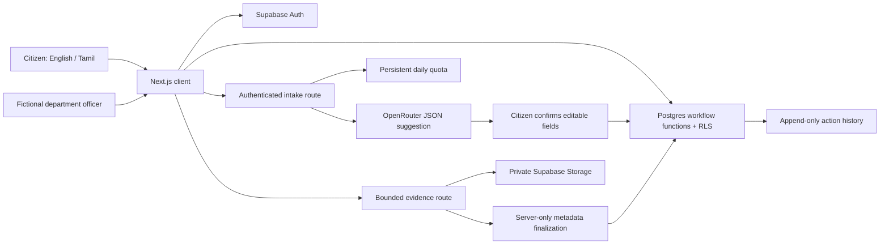

# Architecture

The client uses a Supabase publishable key. Postgres RLS permits citizens to read their own cases and officers to read cases assigned to their department. Officer roles are administratively provisioned and cannot be created or changed by client accounts. Client table writes are revoked. `submit_complaint`, `transition_complaint` and `reassign_complaint` implement constrained state changes and write events in the same transaction. Status and appeal transitions lock the complaint row to prevent race conditions.

AI is advisory. Model output is validated against a fixed enum; unsupported fields cannot become routing instructions. The citizen confirms the category and address. Both TypeScript and Postgres independently map categories to the simulated directory. Road ownership uncertainty, non-Chennai reports and ambiguous categories go to triage. A review officer can forward with a recorded reason. This is deterministic routing under reported inputs, not a guarantee of real-world jurisdiction correctness.

The intake route validates the bearer token using Supabase Auth and enforces a 30-request daily account quota before calling OpenRouter. Demo mode never calls the paid endpoint. Missing configuration, failed responses and invalid model JSON all fall back to guided intake. No API key is sent to the browser.

The evidence route bounds bytes before multipart parsing, validates basic file signatures, calculates SHA-256, uploads unchanged bytes with the user's access rights, then finalizes metadata with a server-only service key. Only the service role may call `attach_evidence`; it validates the actor, complaint, workflow state, object path and attachment limit. Normal users cannot forge checked metadata by invoking the RPC directly. Client writes cannot overwrite or delete registered evidence. File access uses RLS and short-lived signed URLs. Exact duplicate detection is scoped to the same case to avoid revealing another citizen's submissions. No media is transmitted to OpenRouter in this version.

The browser-only demo uses localStorage for case metadata and IndexedDB for attachments. It is intentionally a single-browser simulation and has no role security boundary. Connected mode never silently falls back to demo storage if Supabase configuration is absent.

Ordinary and urgent cases use 21-day and 1-day internal targets. Overdue is a displayed state, not an automatic closure, emergency dispatch or scheduled escalation. Urgency signals and the review UI advise citizens to contact emergency services directly for immediate danger.

Evidence relevance/authenticity, verified asset ownership, officer team hierarchy, public aggregate analytics, notification delivery and automatic escalation remain future extensions. Current public-facing screens reveal no other citizens' data.

## Routing upgrade 202611010002

The verified directory distinguishes TNPDCL distribution from GCC Electrical streetlighting, GCC stormwater from CMWSSB water/sewers, and municipal road ownership from uncertain roads. Exact official sources and exclusions are recorded in [routing research](ROUTING_RESEARCH.md).

Model output must provide an allowed category, bounded confidence, exact complaint evidence and a review flag. A deterministic bilingual electrical-hazard rule overrides a wrong AI road suggestion. Unsupported/ungrounded/disagreeing or uncertain output goes to triage; the citizen confirms editable fields. The model never supplies an operational department. Immediate hazard guidance appears before submission, and the urgency flag cannot downgrade detected risks.

PostgreSQL recomputes the category safety signal and assignment independently, retains a versioned initial routing explanation, escalates priority and audits submission. Client-supplied authority metadata is ignored. A conflicting citizen category is held for triage rather than silently rerouted. Private, telecom and transmission assets require ownership review. Existing records remain unchanged. Before connected submission the app checks `routing_version()`; stale or missing hosted schema fails closed. The separate transaction-wrapped upgrade is never run automatically. Local SQL tests exercise both migrations and cross-layer routing parity without hosted access.
